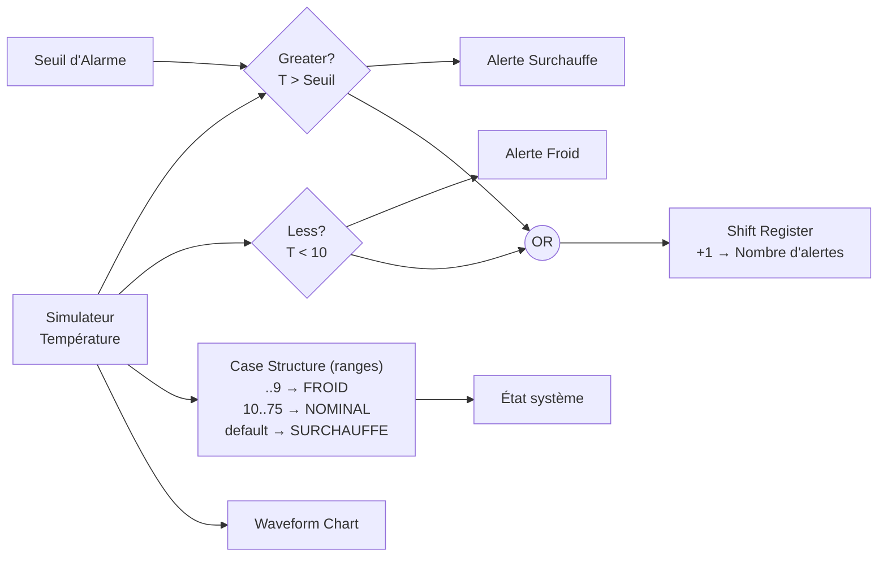
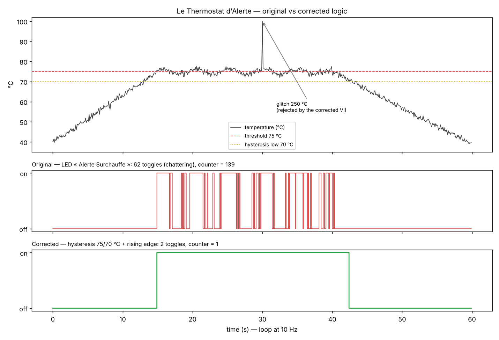

# Le Thermostat d'Alerte — LabVIEW

Group project (Group 2, **IFRI — Université d'Abomey-Calavi**, 2025-2026): temperature supervision in **LabVIEW** using comparisons and Boolean logic. The VI shows the temperature, raises an **overheat alarm** above an adjustable threshold and a **cold alarm** below 10 °C, keeps a trend chart and counts the alerts.

## Front panel

| Element | Type | Role |
| --- | --- | --- |
| Simulateur Température (°C) | Slider 0–100 | simulated sensor input |
| Affichage Température | Thermometer | displays the current temperature |
| Seuil d'Alarme | Numeric control (default **75 °C**) | overheat threshold, adjustable while running |
| Alerte Surchauffe | LED (red) | on when **T > threshold** |
| Alerte Froid | LED (blue) — *the challenge* | on when **T < 10 °C** |
| État système | String | `FROID` / `NOMINAL` / `SURCHAUFFE` |
| Tendance | Waveform Chart | temperature history |
| Nombre d'alertes | Numeric indicator | alert counter |
| STOP | Button | ends the loop |

## Block diagram



- **While loop** paced by `Wait (ms)` = 100 ms, so the VI runs in **real time at 10 Hz**.
- `Greater?` and `Less?` comparators with **strict** bounds: exactly 75 °C is still nominal.
- **Case Structure with ranges** (`10..75` = nominal zone) for the text status.
- **Shift Register** to accumulate the alert counter across iterations.
- The **STOP** button is wired to the loop's conditional terminal.

Extras done beyond the specification: 10 Hz real-time loop, 3-zone text status, trend chart, alert counter.

## Tests

| Input | Overheat | Cold | Status |
| --- | --- | --- | --- |
| 5 °C | off | **on** | FROID |
| 10 °C | off | off | NOMINAL (strict bound) |
| 50 °C | off | off | NOMINAL |
| 75 °C | off | off | NOMINAL (strict bound) |
| 76 °C | **on** | off | SURCHAUFFE |
| threshold changed to 60, T = 65 °C | **on** | off | SURCHAUFFE* |

\* With a threshold different from 75, the Case Structure (fixed range `10..75`) and the LED can disagree. This is one more reason to compute the status from the same comparison as the LED.

## Limits identified and corrections

The [`model/thermostat.py`](model/thermostat.py) script reproduces the VI logic in Python. It replays a noisy temperature that stays around the threshold, with an out-of-range sensor glitch:



| Limit | Effect in the simulation | Correction |
| --- | --- | --- |
| **Chattering** around the threshold | the LED toggles **62 times** in 25 s | **hysteresis 75 / 70 °C**: on above 75, off below 70 → **2 toggles** |
| The counter counts **loop cycles**, not events | **139** "alerts" for a single overheat | count on the **rising edge** (`Feedback Node` + `AND NOT previous`) → **1** |
| No validation of the measurement | a 250 °C glitch is treated as real | reject values outside 0–100 °C (`In Range and Coerce`) |

```bash
pip install matplotlib
python model/thermostat.py
```

```
Original : LED toggled  62 times, counter = 139
Corrected: LED toggled   2 times, counter = 1, invalid samples rejected = 1
```

In LabVIEW, the corrected overheat logic is: `hot = previous ? (T > threshold − 5) : (T > threshold)`. It is built with a Feedback Node holding the previous state and a `Select`. The counter increments on `hot AND NOT previous`.

## Presentation

A 12-slide presentation goes with the project: context, specification, front panel, algorithm, inverse logic, tests, extras, limits, demo, conclusion.

## Structure

```
labview/            LabVIEW source (Thermostat_Alerte.vi)
model/thermostat.py Python model of the VI: original vs corrected logic
docs/chattering.png
```

## Team

AZAÏNON Bradley · DEKADJEVI Elom · GOUNOUKON Uriel

**Supervisor:** Mr Geoffroy ZANNOU
